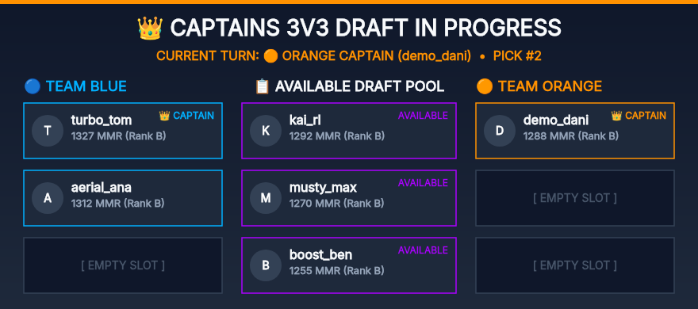
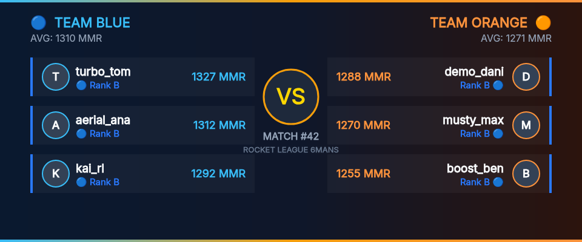
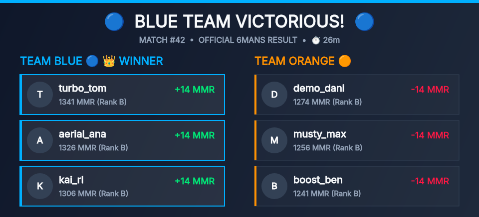
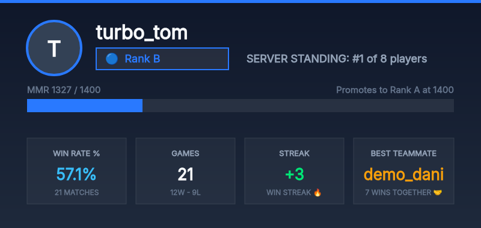

# Rocket League 6mans Discord Bot

A Discord bot that runs pickup games ("6mans") for Rocket League communities: players
queue, the bot builds balanced teams, sets up private channels and a lobby, collects the
result and keeps an MMR ladder. It is live on several Discord servers, self-hosted on a
Raspberry Pi 5 running Ubuntu Server.

**Stack:** TypeScript, Node.js 24, discord.js v14, SQLite (`better-sqlite3`), `canvas` for
the generated image cards, Vitest.

## What it does

- **Button-driven queue.** Players join, leave and check stats from a panel; no commands
  to remember.
- **Team-mode vote.** When the queue fills, players choose Captains Draft, Balanced (by
  MMR) or Random.
- **Captains draft** from a dropdown that shows each player's MMR.
- **Match setup:** a private match channel, a generated lobby name and password, and
  temporary team voice channels.
- **Reporting and moderation:** results are confirmed by the players; admins can override
  or cancel.
- **Ladders per server and team size** (2v2, 3v3, 4v4), with rank divisions, seasons,
  promotion and relegation.

Every stage gets an image card, drawn on the server with `canvas` (sample players):

| Captains draft | Match-up |
|---|---|
|  |  |
| **Result** | **Player profile** |
|  |  |

## How it runs

The production bot runs on a Raspberry Pi 5 with Ubuntu Server, managed by systemd.

- **Continuous deployment.** A systemd timer checks `main` every 15 minutes. When it has
  moved, the Pi pulls, runs the test suite, builds into a separate folder and swaps it in
  before restarting the service. A failed test or build rolls back, leaves the running bot
  untouched and opens a `deploy-failed` GitHub issue
  ([`scripts/pi/`](scripts/pi/)).
- **CI** runs the typecheck and tests on every pull request.
- **Backups:** a daily SQLite snapshot on the Pi, plus a nightly off-site copy to a
  private repo ([`scripts/offsite-backup.sh`](scripts/offsite-backup.sh)).
- **Monitoring:** unexpected errors are filed as GitHub issues automatically, with the
  commit, host and recent log lines attached. While connected to Discord, the bot pings an
  external uptime monitor, which alerts when the pings stop. The Pi needs no open ports.
- **Resilience:** a Discord outage means the bot waits and retries rather than exiting.
  After a restart, it cleans up matches that were mid-setup and tells those players to
  queue again.

How the code is organised, and why, is in [docs/ARCHITECTURE.md](docs/ARCHITECTURE.md).
Running and fixing it is in [docs/OPERATIONS.md](docs/OPERATIONS.md).

---

## 👋 For server admins (the bot is already running)

If someone is hosting the bot for you, setup is three steps:

1. **Invite the bot** with the link you were given. It needs *Manage Channels*, *Manage Roles*, *Manage Messages*, *View Channels*, *Send Messages*, *Read Message History*, *Embed Links*, *Attach Files*, *Connect*, *Speak*, *Move Members*, *Mention @everyone, @here and All Roles* — or simply *Administrator*. It creates private match channels, and Discord only lets a bot grant permissions it holds itself, so a bot short of any of these fails at the first match with `Missing Permissions`.
2. Run **`/setup`** in any channel. Pick how many rank divisions you want:
   - `One ladder` — everyone queues together. Right for most servers. It is called **6mans** everywhere (sidebar, panel, cards); pass `name:` to call it something else.
   - `Three` (C/B/A) or `All five` (C/B/A/X/S) — separate ladders, players are placed by an admin with `/division place`.
   Add `roles:true` if you want each rank category visible only to its rank role. `/setup` is safe to run again — it only adds what is missing. Run it once per team size (`size:2v2`, `size:4v4`) if you want more than 3v3.
3. Players click **Join Queue** on the panel in their rank channel. That is it.

---
## 🛠️ Quick Setup Guide

### 1. Create a Discord Bot Application
1. Go to the [Discord Developer Portal](https://discord.com/developers/applications) and click **New Application**.
2. Under the **Bot** tab:
   - Click **Reset Token** and copy your **Bot Token**.
   - Enable the following **Privileged Gateway Intents**:
     - `Server Members Intent` (optional, for member lookups)
3. Under the **OAuth2 -> URL Generator** tab:
   - Select scopes: `bot` and `applications.commands`.
   - Select bot permissions:
     - **Recommended (Easiest Setup)**: Select **Administrator** so the bot can freely create private match channels, set permission overwrites, and auto-move players without API `50013 Missing Permissions` errors.
     - **Granular Permissions (if not using Administrator)**:
       - `Manage Channels` & `Manage Roles` (called **Manage Permissions**; required by Discord API v10 to create channels with custom permission overwrites)
       - `Manage Messages` (required for score reporting, button interaction cleanup, and match cancel overrides)
       - `Move Members` (required to auto-move players into voice channels)
       - `Send Messages`, `Embed Links`, `Read Message History`, `Connect`, `Speak`, `Use Application Commands`
       - `Mention @everyone, @here and All Roles` (the first player into an empty queue pings that division's role; the roles `/setup` creates are not mentionable by members, so without this the ping posts but notifies nobody)
4. Copy the generated OAuth2 invite URL and invite the bot to your Discord server!
5. **In your Discord Server (`Server Settings -> Roles`)**, ensure the Bot's role has **Administrator** (or all permissions listed above) checked, and delete any existing `🎮 ACTIVE 6MANS MATCHES` category if it was created with restrictive permissions.

### 2. Configure Environment Variables
Copy `.env.example` to `.env`:
```bash
cp .env.example .env
```
Open `.env` and fill in:
- `DISCORD_TOKEN`: Your Discord Bot Token
- `CLIENT_ID`: Your Discord Application Client ID
- `GUILD_ID`: (Optional) Your Discord Server (Guild) ID for instant slash command registration

### 3. Install & Start
```bash
# Install dependencies
npm install

# Register slash commands with Discord (optional: the bot also registers on boot)
npm run register

# Run the bot in development mode
npm run dev

# Or build for production
npm run build
npm start
```

---

## 🎮 Slash Commands

Commands marked *Admin* are hidden from members by Discord's default permissions; server
admins can change who sees them under *Server Settings → Integrations*. Most commands that
read a ladder take an optional `size:` (2v2 / 3v3 / 4v4), defaulting to 3v3.

| Command | Who | What it does |
| :--- | :--- | :--- |
| `/setup` | Admin | Creates rank categories, queue channels, panels and (optionally) roles in one go; safe to re-run |
| `/queue panel [size] [division]` | Admin | Registers this channel as a queue and posts the panel |
| `/queue status` | Everyone | Current queue and who is waiting |
| `/queue add` / `remove <user>` | Admin | Adds or removes a player by hand (an admin add bypasses the division gate) |
| `/queue clear` | Admin | Empties the queue |
| `/queue fill-bots` | Admin | Pads the queue with test bots, for solo testing |
| `/queue force-pop [mode]` | Admin | Fills and pops now, in `balanced`, `captains` or `random` |
| `/match list` | Everyone | Live matches |
| `/match report <winner> [match]` | Admin | Settles a result (`match` is the N in `#match-N`; defaults to this channel's match) |
| `/match cancel [match]` | Admin | Cancels a match and removes its channels |
| `/match cleanup [match]` / `cancel-all` | Admin | Tidies leftover match channels / cancels every live match |
| `/replay check <files> [match]` | Admin | Reads `.replay` uploads and posts the scoreboards, to settle a dispute; never changes a result |
| `/stats [user]` | Everyone | Profile card: MMR, division, W/L, streak |
| `/leaderboard` | Everyone | Top players on a ladder |
| `/history [user]` | Everyone | Recent matches |
| `/set-mmr <user> <mmr>` | Admin | Sets a player's MMR |
| `/division list` / `check [user]` | Everyone | Divisions with their thresholds and channels / a player's division |
| `/division place` / `configure` | Admin | Puts a player in a division / changes a division's name, channel, role or thresholds |
| `/season info` / `history` | Everyone | The current season / past seasons and their champions |
| `/season end confirm:<name>` | Admin | Ends the season: snapshots standings, promotes/relegates, resets every MMR to its division's default. Refuses while anything is live. Never runs on its own |
| `/ban add` / `remove` / `check` / `list` | Admin | Queue bans: `30m`, `12h`, `7d`, `2w`, `1mo` or `permanent` |
| `/theme set` / `reset` / `preset` / `list` / `show` | Admin | The server's card colours |
| `/help` | Everyone | How the bot works |

---

## 🏆 Ranks

Players sit in a **division** (C, B, A, X, S; or one ladder for the whole server), each with
its own starting MMR (1000 / 1300 / 1500 / 1700 / 1900). MMR moves every match; the
division only changes at a season end, by promotion or relegation, or when an admin uses
`/division place`.

---

## 📚 Docs

| Doc | What's in it |
|---|---|
| [PROGRESS.md](PROGRESS.md) | Status and the backlog of what is left to do |
| [docs/ARCHITECTURE.md](docs/ARCHITECTURE.md) | How the code works, settled design, rules |
| [docs/OPERATIONS.md](docs/OPERATIONS.md) | Deploying to the Pi, logs, backups, the dev bot |
| [docs/TESTING.md](docs/TESTING.md) | Checklist for a live test run |
| [docs/PITCH.md](docs/PITCH.md) | Copy for offering the bot to a new server |
| [docs/history/](docs/history/) | The original audit and the build log |
